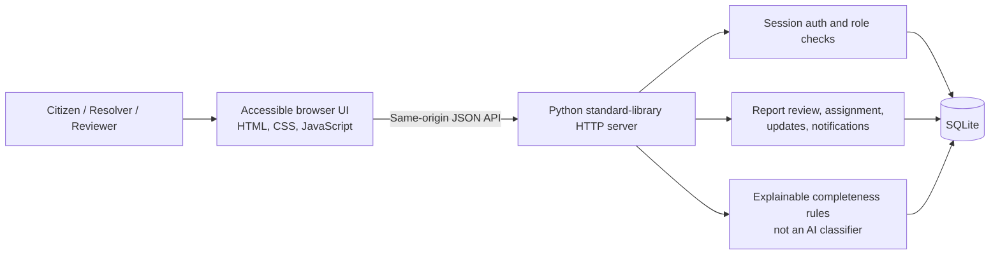

# Architecture and implementation boundaries

## Components

The application intentionally has no runtime or third-party Python dependencies. `server.py` serves both the static browser application and same-origin JSON endpoints. A local SQLite database stores accounts, sessions, reports, report events, notifications, and audit records. The database is created on first run.

## Report lifecycle

`AWAITING_VERIFICATION` → human review (`ADDITIONAL_EVIDENCE_REQUIRED`, `UNDER_HUMAN_REVIEW`, `SUPPORTED_BY_EVIDENCE`, or `REJECTED_AFTER_REVIEW`) → admin assignment (`ASSIGNED`) → resolver updates (`IN_PROGRESS`) → resolution submitted (`RESOLUTION_SUBMITTED`) → reporter confirmation (`RESOLVED`) or dispute (`DISPUTED`).

Status changes are role-checked on the server and recorded in the report timeline. Review notes are required; only authorized admins may review or assign. Resolvers can update only their own assigned reports. Citizens can access and confirm only their own reports. New registrations cannot select an elevated role.

## SQLite records

- `users`: name, email, scrypt password hash, role, creation time.
- `sessions`: hash of an opaque session token, account, expiry.
- `reports`: tracking identifier, reporter, category, narrative, approximate textual location, optional coordinates, privacy preference, assignment, status, and resolution note.
- `report_events`: append-only workflow notes with the responsible actor when known.
- `notifications`: in-app messages for review, assignment, and resolution changes.
- `audit_log`: records key admin and report workflow actions.

The schema is initialized by `init_db()` in `server.py`; report and event indexes support the primary list and timeline queries.

## TrustShield scope

TrustShield checks whether a description, category, location, and optional evidence note were provided. It presents each check as an explainable signal and flags that reports remain subject to human review. It does not analyze uploaded imagery, calculate confidence, determine whether a user is truthful, or automatically reject a report.

GPS is optional and is collected only after an explicit opt-in and browser permission. Coordinates are omitted from API responses unless the reporter opted in and the requester is the reporter, an administrator, or the report's assigned resolver.

## Not implemented

This is a local demo, not a production deployment:

- No React/Vite, Node/Express, PostgreSQL, Prisma, Docker, or automated database migration framework.
- No Azure SDK or external integrations; Azure variables in `.env.example` are placeholders only.
- No real map, geocoding, image upload/storage/analysis, email, audio input, translation, password reset, or public issue feed.
- No secure remote deployment, HTTPS termination, CSRF-token framework, hardened abuse controls, or production operational monitoring.

Do not expose this demo server to untrusted networks or use real citizen information.
